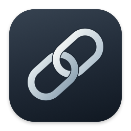

<h1 align="center">이음 · Ieum</h1>

by dicass

Mac 사이의 입력과 자료를 이어 주는 도구

<a href="https://github.com/dicass/ieum/releases/latest">최신 버전 다운로드</a> · <a href="USER_GUIDE.md">사용설명서</a> · <a href="CHANGELOG.md">변경 내역</a> · <a href="SUPPORT.md">문제 해결</a> · <a href="SECURITY.md">보안</a> · <a href="PRIVACY.md">개인정보</a>

**최신 버전 0.11.27 · macOS 14 이상 · Apple Silicon**

원격 Mac을 쓰면서 한영 전환이 헷갈리거나, 복사한 자료와 파일을 여러 Mac에서 이어 쓰고 싶을 때 이음을 사용해 보세요. 클립보드 보관, 단축키 안내, 글자 추출처럼 Mac 한 대에서도 쓸 수 있는 기능이 있습니다. 필요한 기능만 켜서 사용할 수 있어요.

## 이음으로 할 수 있는 일

| 기능 | 이렇게 쓰세요 |
| --- | --- |
| 한영 전환 | Caps Lock으로 빠르게 전환하고, 원격 앱마다 입력 상태를 동기화하거나 상대 Mac의 언어를 고정합니다. |
| 원격 단축키 | 활성 원격 창에서 기본 동작 유지·원격 우선·로컬 우선과 단축키별 예외를 정합니다. |
| 단축키 안내 | 클릭한 기능의 단축키를 확인하고, 한눈에 보기에서 검색·충돌 검사·빈 조합 추천을 사용합니다. |
| 클립보드·창고 | 복사 기록을 찾거나 텍스트·이미지·파일을 골라 보관합니다. 파일은 원본 링크와 사본 중에서 선택합니다. |
| 통합 파일 관리 | 이 Mac과 연결된 Mac의 폴더를 Finder처럼 탐색합니다. 같은 Mac의 여러 위치도 탭·바둑판으로 배치하고 검색·즐겨찾기·미리보기를 사용합니다. |
| 여러 Mac으로 보내기 | Finder·창고·클립보드에서 받을 Mac과 저장 위치를 고릅니다. 20 GiB를 넘는 파일 전송과 일시정지·재연결 후 이어보내기를 지원합니다. |
| 글자 추출 | 화면의 필요한 영역이나 이미지에서 글자를 읽어 복사합니다. |
| 잠자기 관리 | 시간 지정·무제한·조건별 잠자기 방지와 등록한 Mac 깨우기를 사용합니다. |
| 디스플레이 관리 | 여러 모니터를 함께 보며 지원하는 밝기·음량·입력을 조절하고, 프리셋과 화면 배치를 저장합니다. |

원격 화면 연결은 사용하던 원격 데스크톱 앱을 이용하고, 이음에서 입력 규칙과 자료 공유를 설정합니다.

단축키 안내에 별도 설정이 필요한 앱은 **단축키 안내 → 앱 연동·화면 읽기 → 앱별 단축키 안내**에서 방법을 확인하세요. 옵시디언의 그래프 뷰 등 내부 명령은 앱의 **명령줄 인터페이스**를 켜면 현재 지정된 키를 읽습니다. 설정 상태를 확인할 수 있고, 키가 지정되지 않은 기능에는 임의의 단축키를 표시하지 않습니다.

통합 파일 관리에서는 Mac별 표시 체크와 왼쪽에 놓을 Mac 선택을 따로 정합니다. 양쪽 Mac에 **이음 0.11.20 이상**이 필요하며, 상대 폴더를 보려면 파일이 있는 Mac의 **일반 → 자료 공유**에서 상대별 읽기를 허용해야 합니다. 받기 폴더의 내용은 자동으로 공개되지 않습니다. 현재 탐색 화면에서는 탐색·미리보기를 제공하며, 복사·이동·이름 변경·휴지통은 아직 제공하지 않습니다. 파일 전송은 Finder·창고·클립보드에서 시작하세요.

## 큰 파일을 보낼 때

파일·폴더의 20 GiB 전송 한도를 없애고 실제 여유 공간을 확인합니다. 양쪽 Mac 모두 **이음 0.11.20 이상**이어야 하며, 보낼 자료를 준비하는 공간과 받는 쪽의 임시·최종 저장 공간이 필요합니다. **창고의 전체 100 GiB·500개 보관 한도와 텍스트·이미지의 항목당 50 MiB 한도는 유지합니다.** 창고 한도를 넘는 파일은 상대가 허용한 저장 폴더로 직접 보내세요.

지정 폴더에는 받은 파일을 저장하고 창고·복사 기록에는 그 위치를 기억해 중복 보관을 줄입니다. 전송 처리도 최적화했으며 별도로 고속 모드를 켤 필요는 없습니다. 실제 속도는 네트워크와 저장 장치에 따라 달라집니다. 연결이 끊기거나 앱을 다시 실행해도 남은 전송 자료와 임시 파일이 유지돼 있으면 받은 지점부터 이어 보낼 수 있습니다.

양쪽 Mac을 **이음 0.11.26 이상**으로 업데이트하면 파일 전송에 필요한 데이터량과 처리 비용을 줄이는 새 방식이 자동 적용됩니다. 상대가 구버전이면 기존 방식으로 전송합니다. 서로 다른 장소에서는 보내는 쪽 업로드·받는 쪽 다운로드·두 Mac 사이의 연결 경로가 속도에 영향을 줍니다.

## 처음 설치하기

1. [최신 설치 파일 — Ieum-0.11.27.dmg](https://github.com/dicass/ieum/releases/download/v0.11.27/Ieum-0.11.27.dmg)을 받습니다.
2. DMG를 열고 이음 아이콘을 **Applications** 폴더로 끌어다 놓습니다.
3. 복사가 끝나면 **응용 프로그램** 폴더에서 이음을 실행합니다.
4. 사용할 기능을 켜고, 그 기능에 필요한 권한을 허용합니다.

처음 실행할 때 **기능 소개**에서 통합 파일 관리와 대용량 전송 등 주요 기능의 사용 예시를 볼 수 있습니다. **다음·이전·왼쪽 기능 선택**으로 이동하며 실제 전송이나 기기 제어를 실행하지 않습니다. **일반 → 시작·표시 → 기능 소개 → 다시 보기** 또는 **도움말 → 기능 소개**에서 다시 열 수 있습니다.

기존 앱을 DMG로 바꿀 때는 진행 중인 전송을 마치고 이음을 먼저 종료해 주세요. DMG 안의 앱을 계속 실행하지 말고 응용 프로그램 폴더에 설치해 사용하세요.

현재 배포 파일은 **Apple Silicon Mac용**입니다. Intel Mac용 빌드는 제공하지 않습니다. 배포 앱은 Developer ID로 서명하고 Apple 공증을 거칩니다. 파일의 SHA-256은 각 릴리스 설명과 `SHA256SUMS.txt`에서 확인할 수 있습니다.

## 어떤 권한이 필요한가요?

| 권한 | 필요한 기능 |
| --- | --- |
| 손쉬운 사용 | 한영 전환 키 제어, 다른 앱의 단축키 읽기·입력·붙여넣기 |
| 화면 기록 | 화면 영역에서 글자 추출. 이미지 파일만 읽을 때는 필요하지 않습니다. |
| 로컬 네트워크 | 다른 Mac 찾기·연결·자료 공유 |
| Finder 확장 | Finder 우클릭 메뉴에서 창고에 담기·다른 Mac으로 보내기 |

권한은 사용하는 Mac마다 허용해야 합니다. 설정을 동기화해도 macOS 권한까지 옮겨지지는 않아요. 자세한 순서는 [사용설명서](USER_GUIDE.md)에 있습니다.

## 보안과 개인정보

이음은 Developer ID 서명·Apple 공증과 서명된 업데이트 검증을 사용합니다. 자동 설치는 기본으로 꺼져 있습니다. 서명과 공증은 배포 경로와 알려진 악성 코드에 대한 방어이며, 모든 동작의 안전성을 보증하지는 않습니다.

[보안 안내](SECURITY.md)에서 설치 파일 확인 방법과 검증의 한계를, [개인정보 안내](PRIVACY.md)에서 기능별 접근 정보·저장·전송·삭제 방법을 확인하세요. **외부 전문업체의 독립 보안 감사는 아직 받지 않았습니다.** 보안 문제는 공개 이슈에 상세 내용을 올리지 말고 [비공개로 제보](https://github.com/dicass/ieum/security/advisories/new)해 주세요.

## 다른 Mac과 함께 쓰기

양쪽 Mac에 이음을 설치하고 **한영 전환 → 연결 기기**에서 상대를 추가하세요. 상대 Mac의 승인을 받아 연결한 뒤 공유 기능과 받을 폴더를 정합니다. 여러 Mac으로 파일을 보낼 때는 받는 Mac마다 연결과 폴더 허용이 필요합니다.

VPN을 사용한다면 VPN 연결도 먼저 확인해 주세요. 파일 전송의 연결 인증 시간 초과는 상대 Mac의 이음 실행 여부와 네트워크 연결부터 확인하면 좋습니다.

원격 단축키 전달은 양쪽의 입력 제어와 상대 Mac의 **단축키 받기** 허용이 필요합니다. 일반 앱 단축키를 중심으로 처리하며, 일부 시스템 단축키는 macOS와 원격 앱의 설정을 따릅니다. 단축키 안내 범위와 모니터 조절·깨우기 지원 여부도 앱·기기·연결 환경에 따라 달라집니다.

## 다음 버전은 앱에서 받으세요

0.11.15부터 메뉴바 아이콘 우클릭 → **업데이트 확인…**, 또는 **일반 → 시작·표시 → 업데이트**에서 새 버전을 설치할 수 있습니다. 기본값은 자동 확인이며 설치 전에 알려드립니다. 미리 다운로드하고 종료할 때 설치하도록 바꿀 수도 있습니다.

0.11.19부터 진행 중인 자료 전송과 저장을 기다리는 동안 입력 동기화를 유지하고, 설치 직전에 이음의 입력 연결만 잠시 정리합니다. 원격 화면 연결은 유지합니다. 대기 창에서 이유를 확인하거나 설치를 취소할 수 있으며, 자동 업데이트로 재실행하면 설치 직전의 입력 제어 상태를 한 번 복원합니다. 이 동작은 0.11.19에서 이후 버전으로 업데이트할 때부터 적용됩니다. 자동 업데이트가 없는 이전 버전에서는 이번 설치 파일로 한 번 직접 바꿔 주세요.

## 이번 버전에서 달라진 점

파일 전송 목록 오른쪽의 세로 스크롤바가 창 배경과 자연스럽게 어울리도록 다듬었습니다.

- 밝은 테마에서 이질적으로 보이던 스크롤바 바탕 띠를 없애고 팝업 배경이 이어지도록 했습니다.
- 스크롤바 손잡이 색은 파일 전송 창의 밝은·어두운 테마를 따릅니다. 테마를 바꿔도 현재 보고 있던 목록 위치를 유지합니다.
- macOS의 스크롤바 표시 설정과 기본 스크롤 동작은 유지합니다.

[전체 변경 내역](CHANGELOG.md) · [이번 릴리스](https://github.com/dicass/ieum/releases/tag/v0.11.27)

## 도움이 필요할 때

앱의 각 기능에 있는 **물음표**를 누르면 전체 도움말이 열립니다. 인터넷 없이도 읽을 수 있어요. GitHub에서는 [사용설명서](USER_GUIDE.md)를 읽거나 [문제 신고·기능 제안](https://github.com/dicass/ieum/issues/new/choose)을 남길 수 있습니다.

이 저장소에는 **설치 파일, 사용 안내, 변경 내역**을 제공합니다. 이음 앱의 개발 소스와 개발 저장소 이력은 포함하지 않습니다. Releases의 **Source code** 파일은 이 배포 저장소의 문서 묶음이므로 앱을 설치하려면 **DMG**를 받으세요.
